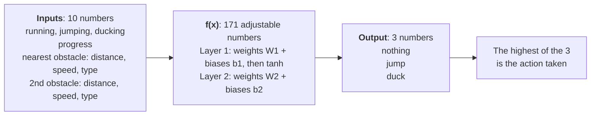
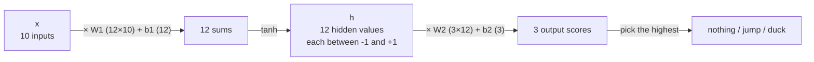
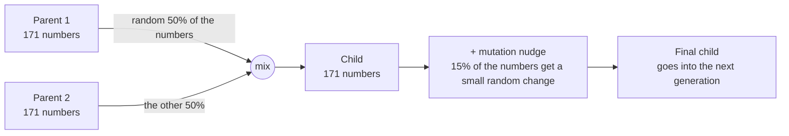
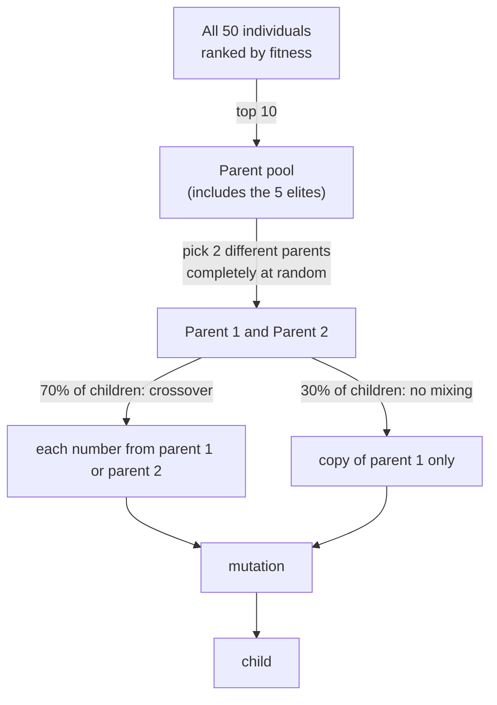
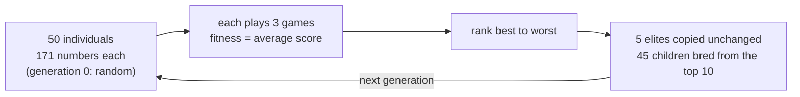

# The brain and the breeding

Two questions this page answers: **what is the brain, and how does it change from one generation to the next?** The diagrams are Mermaid, which renders on GitHub and in VS Code's Markdown preview.

Code: `ml/network.py` (the brain), `ml/neuroevolution/evolve.py` (the breeding), `game_engine/game.py` (`get_observation`).

---

## 1. The inputs: what the brain sees

Every frame (60 per second) the game hands the brain **10 numbers**. That is all it ever sees: no pixels, no picture.

| # | Name | Values | Meaning |
| --- | --- | --- | --- |
| 0 | `is_running` | 0 or 1 | the player is on the ground and free to act |
| 1 | `is_jumping` | 0 or 1 | mid-jump (new presses are ignored until it lands) |
| 2 | `is_ducking` | 0 or 1 | mid-duck |
| 3 | `progress` | 0 to 1 | how far through the current jump/duck. 0 when running |
| 4 | nearest obstacle: `distance` | 0 to 1 | 1 = just spawned at the right edge, 0 = touching the player |
| 5 | nearest obstacle: `speed` | 0 to 1 | 0 = slowest (220 px/s), 1 = fastest (520 px/s) |
| 6 | nearest obstacle: `type` | 0 or 1 | 0 = ground (jump over it), 1 = air (duck under it) |
| 7 | 2nd obstacle: `distance` | 0 to 1 | same, for the next obstacle |
| 8 | 2nd obstacle: `speed` | 0 to 1 | |
| 9 | 2nd obstacle: `type` | 0 or 1 | |

Notes:
- Inputs 0–2 are three separate flags (not one number) so the net doesn't read "jump" as being between "run" and "duck".
- When there is no second obstacle yet, slots 7–9 read `1, 0, 0` (far away, slow, ground). The distance of 1 is what says "nothing there".
- Everything is scaled to roughly 0..1 so no input drowns out the others.

---

## 2. inputs → f(x) → output



f(x) is nothing more than the **weights, the biases and tanh**. Opened up, with real shapes:



- **Weights** say how much each input matters to each neuron. **Biases** shift a neuron up or down.
- **tanh** squashes any number into -1..+1. It is applied to the hidden layer only; the 3 outputs stay raw because we only compare them with each other.
- Number of adjustable values: `10×12 + 12` (layer 1) `+ 12×3 + 3` (layer 2) `= 171`. These 171 numbers are one individual's **genome**.

### A real example

A trained net (generation 99 of an earlier run, only moderately good) with a ground obstacle coming at it:

```
input x = [1, 0, 0,  0,  0.15, 0.13, 0,  1, 0, 0]

          1, 0, 0        running (not jumping, not ducking)
          0              progress: not mid-jump
          0.15, 0.13, 0  nearest obstacle: close, slowish, ground
          1, 0, 0        no second obstacle

hidden h = [-0.83, 0.96, 0.02, -0.87, 0.18, -0.05, -0.62, 0.06, -0.85, -0.95, 0.92, 0.71]

output   = [-0.42 (nothing),  -0.24 (jump),  -0.47 (duck)]   → highest is jump
```

The raw scores are not probabilities and can be negative; only their order matters. Same net, same situation, as the obstacle gets closer:

| Distance to obstacle | nothing | jump | duck | Net picks | Perfect bot picks |
| --- | --- | --- | --- | --- | --- |
| 0.23 (0.35 s away) | **-0.29** | -0.31 | -0.78 | nothing | nothing |
| 0.15 (0.24 s away) | -0.42 | **-0.24** | -0.47 | jump | jump |
| 0.10 (0.15 s away) | -0.49 | **-0.20** | -0.24 | jump | jump |

So f(x) responds to the input: it waits, then jumps at about the right moment. A worse net would get this wrong.

### The goal

**Find 171 numbers such that f(x) gives the right output for every situation the game can produce.** For this net that means: jump when a ground obstacle is about 0.3 s away, duck for an air obstacle, and do nothing otherwise.

Two honest caveats:
- *"Right" is never labelled.* Nobody tells the net the correct action for each input. The only feedback is the final score, and evolution keeps the numbers that score well. (The perfect bot is a hand-written rule that plays without mistakes in our tests, so it is a useful yardstick, but it isn't used to train.)
- *"Every input" means every input that can occur in play.* There are only so many combinations of obstacle distance, speed and type. That is why we judge a net on **fresh seeds** (`ml/run/watch.py` does by default): a net that only works on the 3 games it was picked on has not really learned f(x).

---

## 3. Elites and parents

After every individual has played, the 50 are ranked by fitness (their average score over 3 games). Two groups matter:

| Group | Who | What happens to them |
| --- | --- | --- |
| **Elites** | the top N individuals (default 5) | copied into the next generation **unchanged** |
| **Parents** | the top N individuals (default 10) | allowed to **have children**. Includes the elites |

Defaults: 50 slots in the next generation = 5 elite copies + 45 children. The number of parents must be at least the number of elites, because the elites are inside the parent pool.

### Elites: copied as they are


Why: mutation is random and usually makes things worse. Without elites the best individual could vanish and the best score fall back. (Its score can still drop a little next generation, because it plays new games.)

### Children: two parents mixed, then nudged



In numbers (a toy genome of 6 instead of 171):

```
parent 1:   [ 1,   2,   3,   4,   5,   6 ]
parent 2:   [10,  20,  30,  40,  50,  60 ]
coin flips:    1    2    1    2    2    1        ← one fair coin per number
child:      [ 1,  20,   3,  40,  50,   6 ]
mutation:      .   +0.3  .    .   -0.2   .      ← each number has a 15% chance
final:      [ 1, 20.3,  3,  40, 49.8,   6 ]
```

- **Crossover:** for each of the 171 numbers, a separate fair coin flip picks parent 1's value or parent 2's. So about half comes from each, not exactly half.
- **Mutation:** each number independently has a 15% chance of getting a random nudge drawn from a bell curve with standard deviation 0.3. Most nudges are small, a few are larger.

### How the parents are chosen



- **The pool is chosen by rank**, not at random: it is exactly the top 10.
- **From the pool, parents are picked at random** and equally likely: the 10th-best is as likely to be picked as the best. Fitness only decides who gets *into* the pool.
- **A child has 2 parents, not 10.** It is not a 10% blend of ten parents. Each number comes whole from one of the two.
- **30% of children skip crossover** and are a copy of one parent, which then gets mutated. That keeps some children close to a proven individual, because mixing two networks can scramble weights that only work together. The 70/30 split is a tuning choice, not a derived value.
- Every child is mutated, so none is an exact copy of anyone. Only the elites are exact copies.

---

## 4. The whole loop



Run it with `ml/run/train.py`, watch it with `ml/run/watch.py`. All the settings (population, elites, parents, hidden neurons, games, seed) are in `docs/03-neuroevolution.md`.
